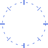
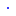

# Aeronautical Symbols

## 1. Airports & Heliports

These are the core point markers for landing facilities.

| Icon | Asset Name | Visual Description | Notes |
| :---: | :--- | :--- | :--- |
|  | `apt-civil-unpaved` | Open circle | Public unpaved civil airports (`civil_soft`) |
|  | `apt-ifr-civil` | Open circle with 12, 3, 6, and 9 o'clock ticks | Public paved civil airports (`civil_hard`); world-space runway polygons render underneath at high zoom |
|  | `apt-ifr-military` | Double concentric circle with central dot | Military airports (`military`);  `apt-ifr-military-civil` variant also available |
|  | `apt-private` | Open circle with an "R" inside | Private-use airports (`private`) |
|  | `apt-helipad` | Open circle with an "H" inside | Public, private, and military heliports/vertiports (`heliport`) |
|  | `apt-seaplane` | Anchor symbol inside ticked circle | Public and private seaplane bases (`seaplane`, `seaplane_private`) |
|  | `apt-ultralight` | Open circle with an "F" inside | Ultralight flightparks (`ultralight`) |
|  | `apt-gliderport` | Open circle with a "G" inside | Gliderports (`gliderport`) |
|  | `apt-balloonport` | Open circle with a "B" inside | Balloonports (`balloonport`) |

### Overlays + Variants

Coloring indicates whether airport is towered (cyan) or not (magenta).

| Icon | Asset Name | Visual Description | Notes |
| :---: | :--- | :--- | :--- |
|  | `apt-fuel-ticks` | Small same-color tick marks sticking out at 12, 3, 6, and 9 o'clock | Legacy overlay; variant icons incorporate ticks directly |
|  | `apt-beacon` | Open 5-point star | Can be dynamically superimposed on base airport icons |

## 2. NAVAIDs

These icons indicate radio navigation aids.

| Icon | Asset Name | Visual Description | Notes |
| :---: | :--- | :--- | :--- |
|  | `nav-vor` | Hexagon with a central dot | |
|  | `nav-vortac` | Hexagon with 3 solid rectangles attached | |
|  | `nav-vordme` | Hexagon inside a square | |
|  | `nav-dme` | Square with a central dot | |
|  | `nav-tacan` | Open triangle with 3 solid rectangles unioned | Mostly military |
|  | `nav-ndb` | Concentric circles with an inner dot array | |
|  | `nav-ndb-dme` | Concentric dot array inside a square | |
|  | `nav-vhfor` | Hexagon with outer tick marks | |
|  | `nav-compass-rose` | Tick-marked outer ring oriented to magnetic north | Often rendered as an icon centered beneath the NAVAID |

## 3. Fixes, Waypoints & Routing

Icons representing specific coordinate points in the sky and VFR routing elements.

| Icon | Asset Name | Visual Description | Notes |
| :---: | :--- | :--- | :--- |
|  | `fix-compulsory` | Solid triangle | |
|  | `fix-non-compulsory` | Open triangle | |
|  | `wpt-rnav-solid` | Solid 4-point starburst | |
|  | `wpt-rnav-open` | Open 4-point starburst | |
|  | `wpt-vfr-checkpoint` | FAA crimson/magenta pennant/flag icon | `VP*` VFR waypoints (NASR `FIX_BASE.csv`); sectional-charted IFR fixes fall back to `fix-compulsory` / `fix-non-compulsory` when IFR Waypoints are hidden |
|  | `pass-mountain` | Brown opposing curved brackets `)(` + elevation label (ft) | Identifies mountain passes |

### Military Training Routes (`IR` / `VR` / `SR`)

| Feature | Representation | Visual Description | Notes |
| :--- | :--- | :--- | :--- |
| **Military Training Routes** (`IR` / `VR` / `SR`) | Line + corridor polygon + label | Centerline with translucent width corridor and route/altitude labels | Instrument (`IR`), Visual (`VR`), and Slow Speed Low Altitude (`SR`) routes from ADDS `MTRSegment` + NASR `MTR_BASE`/`MTR_PT` |

## 4. Obstructions & Relief

Markers for hazards to flight.

| Icon | Asset Name | Visual Description | Notes |
| :---: | :--- | :--- | :--- |
|  | `obs-minor` | Upward pointing chevron with dot | Obstacle < 1000' AGL |
|  | `obs-major` | Tower/Eiffel-shape with dot | Obstacle ≥ 1000' AGL |
|  | `obs-wind-turbine` | Wind turbine icon | |
|  | `pat-wind-farm` | Hatched polygon + outline + FAA MSL/AGL height label | Wind turbine clusters (USGS USWTDB 5 km AEQD + FAA DOF `WINDMILL`) |

### Overlays + Variants

| Icon | Asset Name | Visual Description | Notes |
| :---: | :--- | :--- | :--- |
|  | `obs-minor-lit` | Minor obstacle with radiating light rays | Lighted obstacle < 1000' AGL |
|  | `obs-major-lit` | Major obstacle with radiating light rays | Lighted obstacle ≥ 1000' AGL |
|  | `obs-lighted-mod` | Radiating light rays | Legacy overlay placed on top of standard obstacle icons |

## 5. Enroute Grid & Infrastructure

Vector-rendered grid overlays and linear infrastructure hazards.

| Feature | Visual Description | Notes |
| :--- | :--- | :--- |
| **Power Transmission Lines** | Dashed bronze/amber lines | Overhead lines `>= 115 kV` (HIFLD), voltage-tiered at `z6`/`z7`/`z9` |
| **Grid MORA** | `1° × 1°` latitude/longitude grid with Jeppesen two-tone split labels: teal (`< 14,000 ft`) / crimson (`>= 14,000 ft`) and superscripted hundreds digit | Minimum Off-Route Altitude derived from CIFP `AS` records (`enroute.pmtiles`) |
